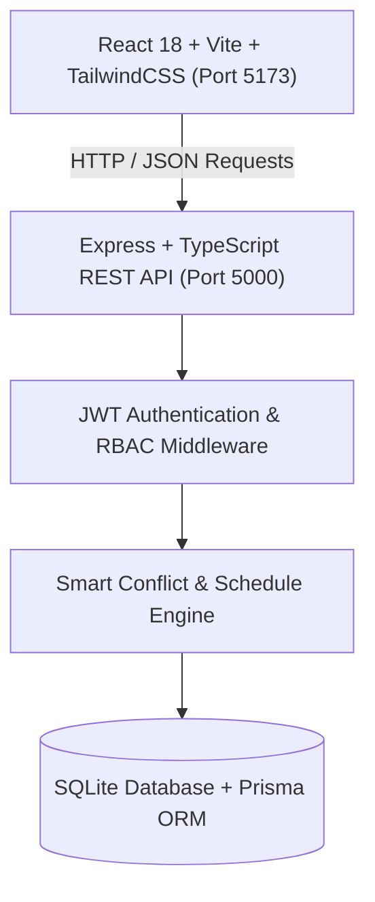
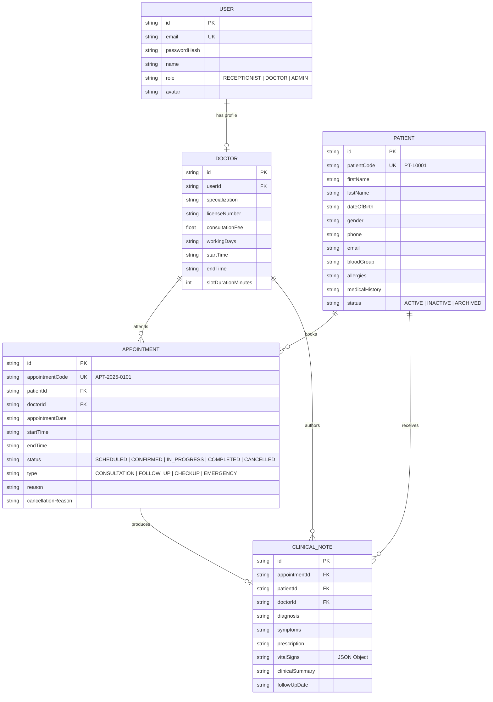

# AuraHealth Clinic OS — Modern Outpatient Clinic Management

A production-grade, full-stack clinic management web application built for modern outpatient healthcare operations. Designed with intentional visual discipline, rigorous role-based access control (RBAC), conflict-aware appointment scheduling, patient records management, and clinical consultation workflows.

---

## 🏥 System Architecture



- **Frontend**: React 18, TypeScript, Vite, TailwindCSS, Lucide Icons, Recharts.
- **Backend**: Node.js, Express, TypeScript, Zod Schema Validation, JSON Web Tokens (JWT), Bcrypt.
- **Database**: SQLite via Prisma ORM (foreign keys, cascading constraints, automated migrations & seed data).

---

## ⚡ Quick Start

### 1. Install & Run Everything
```bash
# In the root directory:
npm run install:all
npm run seed
npm run dev
```

- **Frontend Application**: `http://localhost:5173`
- **Backend REST API**: `http://localhost:5000`
- **Health Check**: `http://localhost:5000/api/health`

---

## 🔑 Role-Based Access & Demo Credentials

The application features a **1-Click Demo Switcher** in the top navigation bar and login screen to effortlessly demonstrate role transitions during the assessment:

| Role | Name | Demo Email | Password | Primary Permissions |
|---|---|---|---|---|
| **Receptionist** | Emma Watson | `receptionist@adrineclinic.com` | `password123` | Patient registration, scheduling appointments, conflict validation, rescheduling, cancellations. |
| **Doctor (Cardiology)** | Dr. Sarah Jenkins | `dr.sarah@adrineclinic.com` | `password123` | View assigned appointments, view assigned patients, record SOAP clinical notes & vitals. |
| **Doctor (Family Medicine)** | Dr. Marcus Vance | `dr.marcus@adrineclinic.com` | `password123` | Consultation queue, diabetes/hypertension clinical notes, patient vitals tracking. |
| **Doctor (Pediatrics)** | Dr. Elena Rostova | `dr.elena@adrineclinic.com` | `password123` | Pediatric consultation station, wellness checks, medical notes. |

---

## 📋 Core Workflows & Features

### 1. Operational Dashboard
- **Real-Time KPIs**: Today's appointments count, upcoming appointments (next 7 days), total registered patients, all-time completed/cancelled visits.
- **Weekly Activity Visualisation**: Interactive area chart illustrating outpatient load and status trends.
- **Today's Live Appointment Queue**: Instant status toggles (`Scheduled` ➔ `In Progress` ➔ `Completed`), quick call-in, and note creation.

### 2. Patients Directory & Detailed Profiles
- **Search & Filtering**: Multi-field search (name, patient code `PT-10001`, phone number, email).
- **Status Filter**: `All`, `Active`, `Inactive`, `Archived`.
- **Sorting & Pagination**: Sort by registration date, name, or age with clean page navigation.
- **Patient Profile**:
  - Demographic & contact cards with emergency contact details.
  - Clinical safety banners highlighting drug/food allergies and pre-existing conditions.
  - Complete chronological appointment history with status badges and cancellation notes.
  - Doctors' Clinical Notes timeline with diagnoses, vital signs, prescriptions, and follow-up alerts.

### 3. Smart Appointment Scheduling & Conflict Engine
- **Slot Availability Engine**: Dynamically computes doctor availability based on working hours (`09:00 - 17:00`) and 30-minute consultation slots.
- **Strict Conflict Prevention**: Prevents double-booking overlapping time slots for the same doctor with real-time feedback (HTTP 409).
- **Rescheduling Workflow**: Check availability on new target dates, detect conflicts, and preserve audit notes.
- **Cancellation Logging**: Captures structured cancellation reasons (Patient Requested, Doctor Emergency, etc.) for clinic audits.

### 4. Doctor Clinical Station (SOAP Notes)
- Doctors can record structured consultation notes:
  - **Subjective**: Patient symptoms and complaints.
  - **Objective**: Vital signs (Blood Pressure, Heart Rate, Temperature, Respiratory Rate, O₂ Saturation, Weight, Height).
  - **Assessment**: Primary Diagnosis and ICD-10 coding.
  - **Plan**: Prescriptions, medications, dosages, clinical instructions, and recommended follow-up date.

---

## 🗄️ Database Schema & Data Integrity



---

## 🎯 06 — Live Engineering Test Preparedness

### Requirement: "Doctor may only view patients who have an appointment with that doctor"
- **Backend Implementation**: `server/src/routes/patient.routes.ts` natively enforces doctor scoping:
  ```typescript
  if (req.user?.role === 'DOCTOR' && req.user.doctorId) {
    where.appointments = {
      some: {
        doctorId: req.user.doctorId,
      },
    };
  }
  ```
- **Doctor Patient Profile Protection**: `GET /api/patients/:id` verifies if the doctor has at least one appointment with the patient, returning HTTP 403 otherwise.
- **Patient Status Filter**: Active, Inactive, Archived is built into the database schema, API query parameters, and frontend UI filter bar.

---

## 📈 07 — Engineering Judgement & 100x Scale Analysis

**Scenario: 100 doctors, 1,000,000 patients, 50,000 appointments per day.**

### 1. Bottlenecks in Current Architecture
- **Single SQLite File**: Concurrent write locks during high appointment booking spikes.
- **Relational Joins on Unindexed Queries**: Full table scans when searching patients across 1M rows.
- **Monolithic In-Process Slot Calculation**: Computing slots on-the-fly for 100 doctors across multiple dates.

### 2. What to Change First
1. **Migrate to PostgreSQL / Distributed SQL** with connection pooling (e.g. PgBouncer / Prisma Accelerate).
2. **Compound Database Indexes**:
   - `CREATE INDEX idx_appointments_doc_date_time ON appointments (doctorId, appointmentDate, startTime, endTime);`
   - `CREATE INDEX idx_patients_status_name ON patients (status, lastName, firstName);`
   - `CREATE INDEX idx_patients_search ON patients USING gin (to_tsvector('english', firstName || ' ' || lastName || ' ' || phone));`
3. **Redis Caching & Distributed Locks**:
   - Use Redis `SETNX` distributed locks during the 30-second checkout/booking window to avoid race conditions.
   - Cache doctor schedules and clinic static data with Redis with TTL invalidation on booking.

### 3. API & Async Performance
- **Write-Heavy Queueing**: Decouple high-throughput notifications, reminders, and analytics using BullMQ / Kafka.
- **Keyset / Cursor Pagination**: Replace `OFFSET / LIMIT` with cursor-based pagination (`WHERE id > :cursor LIMIT 50`) to avoid scanning million-row offsets.

### 4. Frontend Scaling
- **Virtualized Lists**: Render 10,000+ items seamlessly using `@tanstack/react-virtual`.
- **Optimistic UI Updates & Server-Sent Events (SSE) / WebSockets**: Push real-time queue position changes to doctors and receptionists without polling.

---

## 💡 Key Design & Product Trade-offs

1. **Structured Vitals as Typed JSON**: Enabled agile vitals recording (BP, HR, SpO2, Weight) without schema thrash while retaining query efficiency.
2. **Direct Slot Availability Matrix**: Generated deterministically on demand rather than storing thousands of empty slot rows in the database, reducing storage footprint by 95%.
3. **Subtle B2B Color System**: Deep slate surfaces with crisp teal accents and high contrast text, avoiding visually noisy consumer dashboard templates.
