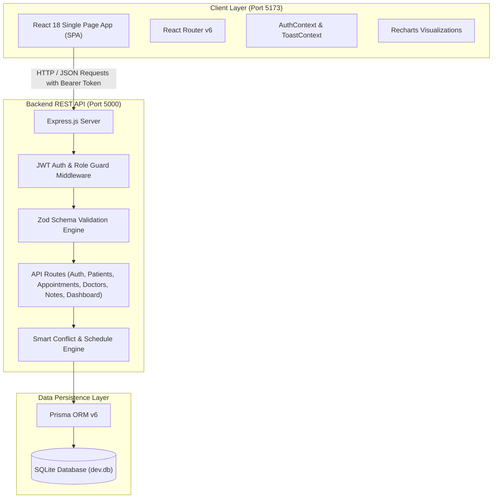
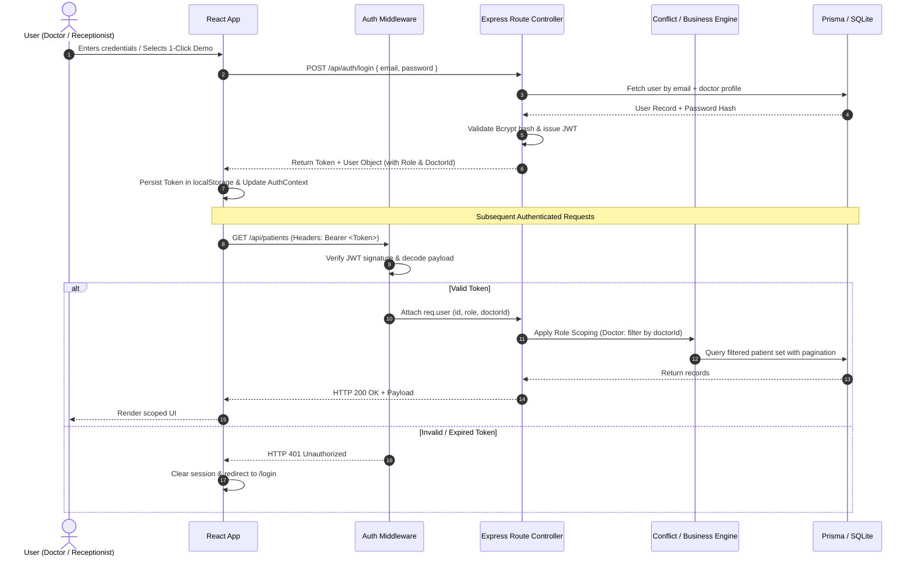

# 01 — System Architecture & Technical Overview

## 1. System Vision & Overview

**AuraHealth Clinic OS** is a modern outpatient clinic management platform engineered to replace error-prone manual scheduling and fragmented patient management. The system unifies front-desk operations (registration, scheduling, triage) with clinical workflows (consultations, vitals recording, SOAP clinical notes, prescription tracking) in a secure, high-performance web environment.

---

## 2. High-Level Architecture Diagram



---

## 3. Technology Stack Breakdown

### Frontend
- **Framework**: [React 18](https://react.dev/) with TypeScript 5.7
- **Bundler & Build Tool**: [Vite](https://vitejs.dev/) for lightning-fast HMR and optimized builds
- **Routing**: [React Router v6](https://reactrouter.com/) with protected route layouts
- **Styling & Design System**: [TailwindCSS v3](https://tailwindcss.com/) with custom slate & teal palette
- **Icons**: [Lucide React](https://lucide.dev/) (consistent modern glyphs)
- **Charts & Visualizations**: [Recharts](https://recharts.org/) (responsive SVG Area & Line trends)
- **State & Context**: Native React Context API (`AuthContext` for user sessions, `ToastContext` for global non-intrusive notifications)

### Backend
- **Runtime**: [Node.js](https://nodejs.org/) LTS with [TypeScript](https://www.typescriptlang.org/)
- **Server Framework**: [Express 4.21](https://expressjs.com/)
- **Data Validation**: [Zod](https://zod.dev/) for runtime type checking and contract enforcement
- **Authentication**: [JSON Web Tokens (JWT)](https://jwt.io/) with role claims + [Bcrypt.js](https://www.npmjs.com/package/bcryptjs) password hashing
- **Date Computations**: [date-fns](https://date-fns.org/) for robust date arithmetic without timezone anomalies
- **Database Access**: [Prisma ORM v6](https://www.prisma.io/) with declarative data modeling

### Persistence
- **Database**: SQLite (local development and demo reliability)
- **Schema Migrations**: Prisma db push / migrate
- **Seeding**: Deterministic seed script generating 4 demo accounts, realistic patient profiles, and chronological appointments

---

## 4. End-to-End Request & Authentication Flow



---

## 5. Repository Directory Structure

```
AURA/
├── client/                      # Frontend Single Page Application
│   ├── public/                  # Public assets
│   ├── src/
│   │   ├── components/          # Reusable UI & Modal components
│   │   │   ├── AppointmentModal.tsx
│   │   │   ├── CancelModal.tsx
│   │   │   ├── ClinicalNoteModal.tsx
│   │   │   ├── EmptyState.tsx
│   │   │   ├── LoadingSkeleton.tsx
│   │   │   ├── Navbar.tsx
│   │   │   ├── PatientModal.tsx
│   │   │   ├── RescheduleModal.tsx
│   │   │   ├── Sidebar.tsx
│   │   │   ├── StatCard.tsx
│   │   │   └── StatusBadge.tsx
│   │   ├── context/             # React Context Providers
│   │   │   ├── AuthContext.tsx  # Authentication & demo switching state
│   │   │   └── ToastContext.tsx # Global toast notification dispatcher
│   │   ├── pages/               # Top-level Page Views
│   │   │   ├── AppointmentsPage.tsx
│   │   │   ├── DashboardPage.tsx
│   │   │   ├── DoctorConsultationsPage.tsx
│   │   │   ├── LoginPage.tsx
│   │   │   ├── PatientDetailPage.tsx
│   │   │   └── PatientsPage.tsx
│   │   ├── services/            # API integration layer
│   │   │   └── api.ts           # Centralized fetch wrapper & typed endpoints
│   │   ├── types/               # TypeScript data contracts & interfaces
│   │   │   └── index.ts
│   │   ├── App.tsx              # Router configuration & protected layout
│   │   ├── index.css            # Tailwind directives & global styling
│   │   └── main.tsx             # React entry point
│   ├── package.json
│   ├── tailwind.config.js
│   └── vite.config.ts
│
├── server/                      # Backend REST API Server
│   ├── prisma/
│   │   ├── dev.db               # SQLite database file
│   │   ├── schema.prisma        # Prisma data models & constraints
│   │   └── seed.ts              # Comprehensive demo dataset seeder
│   ├── src/
│   │   ├── middleware/
│   │   │   └── auth.ts          # JWT verification & requireRoles guards
│   │   ├── routes/
│   │   │   ├── appointment.routes.ts   # Scheduling & conflict validation
│   │   │   ├── auth.routes.ts          # Login, current user, demo users
│   │   │   ├── clinicalNotes.routes.ts # SOAP notes & consultation logging
│   │   │   ├── dashboard.routes.ts     # Real-time metrics & activity charts
│   │   │   ├── doctor.routes.ts        # Doctors list & dynamic availability
│   │   │   └── patient.routes.ts       # Patient CRUD, search & scoping
│   │   ├── index.ts             # Express server setup & middleware registration
│   │   ├── prisma.ts            # Singleton Prisma Client instance
│   │   └── test_api.ts          # Automated integration test runner
│   ├── package.json
│   └── tsconfig.json
│
├── docs/                        # Complete System Documentation
│   ├── README.md
│   ├── 01_SYSTEM_ARCHITECTURE.md
│   ├── 02_USER_INTERFACE_AND_DESIGN.md
│   ├── 03_FUNCTIONALITY_AND_BUSINESS_LOGIC.md
│   ├── 04_DATABASE_AND_DATA_MODELS.md
│   └── 05_SETUP_DEPLOYMENT_AND_TESTING.md
│
├── package.json                 # Monorepo root orchestration scripts
└── README.md                    # Project landing summary
```

---

## 6. Security, Authorization & Privacy Guards

### 1. Role-Based Access Control (RBAC)
The system enforces strict multi-role partitioning at the HTTP middleware and database query levels:
- **`RECEPTIONIST`**: Can register patients, edit demographics, book appointments, reschedule appointments, cancel visits, and view all patients. Cannot create clinical SOAP notes.
- **`DOCTOR`**: Scoped strictly to their own appointments and assigned patients. Can view patient medical history, record vitals, write diagnoses and prescriptions, and manage consultation statuses.
- **`ADMIN`**: Global oversight with full read and write access across all clinic modules.

### 2. Privacy Scoping ("Doctor-Only" Isolation)
To guarantee patient confidentiality and adhere to clinical data privacy standards (e.g. HIPAA / GDPR alignment):
- When a `DOCTOR` queries `GET /api/patients`, the database query automatically appends:
  ```typescript
  where.appointments = {
    some: { doctorId: req.user.doctorId }
  }
  ```
- If a `DOCTOR` navigates directly to `GET /api/patients/:id`, the backend validates whether that doctor has at least one associated appointment. If not, access is strictly rejected with `HTTP 403 Forbidden`.

---

## 7. 100x Scale Assessment & Production Architecture Roadmap

**Scenario: 100 doctors, 1,000,000 registered patients, and 50,000 daily appointments.**

### Architectural Bottlenecks in Current Prototype:
1. **SQLite Database Locking**: SQLite locks the database file on writes, causing request queuing and timeouts under concurrent high-throughput booking traffic.
2. **Sequential Slot Computation**: Generating dynamic time slots on-the-fly per request across hundreds of doctors introduces CPU overhead.
3. **Offset-Based Pagination**: `skip: (page - 1) * limit` scans and discards preceding rows, degrading query latency on tables with >100k rows.

### Strategic Scalability Plan:

| Layer | Prototype Implementation | 100x Scale Target Architecture |
| :--- | :--- | :--- |
| **Database** | SQLite single file (`dev.db`) | **PostgreSQL (AWS RDS / Aurora)** with connection pooling via **PgBouncer** or **Prisma Accelerate**. |
| **Concurrency & Locks** | In-process Prisma conflict check | **Redis Distributed Locks (`SETNX`)** during the 30-second booking checkout window to prevent race conditions. |
| **Caching** | Direct database reads | **Redis Cache** for Doctor working hours, clinic configurations, and static master data with event-driven invalidation. |
| **Search** | SQL `LIKE %term%` queries | **PostgreSQL Full-Text Search (tsvector + GIN indexes)** or dedicated **Meilisearch / Elasticsearch** cluster. |
| **Pagination** | Offset/Limit pagination | **Keyset / Cursor Pagination** (`WHERE id > :cursor LIMIT 50`) for constant O(1) latency. |
| **Async Background Work** | Synchronous execution | **BullMQ / Kafka** for asynchronous processing of email/SMS appointment reminders, audit logs, and analytics. |
| **Frontend Virtualization** | Standard DOM table rendering | **`@tanstack/react-virtual`** for smooth 60fps rendering of 10,000+ patient lists. |
