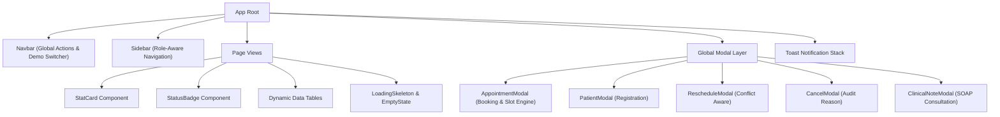

# 02 — User Interface & Design System

## 1. Design Philosophy & Visual System

**AuraHealth Clinic OS** is crafted with an intentional B2B clinical aesthetic that prioritizes visual clarity, reduced cognitive load, rapid task execution, and high contrast for medical professionals under demanding time constraints.

### Core Principles:
- **Clean Slate Surfaces**: Deep slate backgrounds (`#0f172a`, `#1e293b`) for structural elements paired with clean white and light grey work surfaces (`#f8fafc`, `#ffffff`) to maximize focus.
- **Clinical Teal Accent**: Primary interactive elements utilize an emerald-teal palette (`#0d9488`, `#14b8a6`, `#0f766e`), projecting hygiene, trust, and modern precision.
- **Micro-Interactions**: Hover transitions, soft pulse indicators for active consultations, and responsive button feedback without distracting animations.
- **Zero Placeholder Tolerance**: Every UI state is backed by real seeded data, realistic medical conditions (e.g. Hypertension, Type 2 Diabetes, Asthma), real doctor avatars, and actionable status badges.

---

## 2. Color Tokens & Visual Hierarchy

| Token Name | Hex Value | Tailwind Class | UI Context |
| :--- | :--- | :--- | :--- |
| **Primary Brand** | `#0d9488` / `#14b8a6` | `bg-teal-600` / `bg-teal-500` | Primary action buttons, active navigation states, key metric highlights. |
| **Primary Light** | `#f0fdfa` | `bg-teal-50` / `border-teal-200` | Soft highlight badges, selected slot chips, alert card backgrounds. |
| **Slate Dark** | `#0f172a` / `#1e293b` | `bg-slate-900` / `bg-slate-800` | Sidebar navigation, login header, high-contrast modal backdrops. |
| **Surface Background** | `#f8fafc` | `bg-slate-50` | Primary workspace canvas. |
| **Card White** | `#ffffff` | `bg-white` | Elevated data cards, tables, modal containers. |
| **Status Success** | `#16a34a` / `#dcfce7` | `bg-emerald-500` / `bg-emerald-50` | `COMPLETED`, `ACTIVE` status pills, confirmation toasts. |
| **Status Warning** | `#d97706` / `#fef3c7` | `bg-amber-500` / `bg-amber-50` | `SCHEDULED`, `IN_PROGRESS`, impending appointments. |
| **Status Danger** | `#dc2626` / `#fee2e2` | `bg-rose-500` / `bg-rose-50` | `CANCELLED`, `ARCHIVED`, allergy warnings, conflict errors. |
| **Status Info** | `#2563eb` / `#dbeafe` | `bg-blue-500` / `bg-blue-50` | `CONFIRMED`, consultation type tags. |

---

## 3. Global Component Library



### Component Breakdown:

### 1. `Navbar.tsx`
- **Location**: Top of all authenticated views.
- **Features**:
  - Global search prompt for rapid patient/appointment lookup.
  - Quick action buttons: **"+ New Appointment"** and **"+ New Patient"** (visible to Receptionist/Admin).
  - **1-Click Demo Switcher**: Instant dropdown allowing evaluators to switch between Emma Watson (Receptionist), Dr. Sarah (Cardiology), Dr. Marcus (Family Medicine), and Dr. Elena (Pediatrics) without re-typing passwords.
  - Logged-in user badge displaying name, role, specialization, and avatar.

### 2. `Sidebar.tsx`
- **Location**: Left dock with collapsed/expanded responsive support.
- **Features**:
  - Branding header (`AuraHealth OS`).
  - Navigation links:
    - 📊 **Dashboard** (`/dashboard`)
    - 👥 **Patients Directory** (`/patients`)
    - 📅 **Appointments** (`/appointments`)
    - 🩺 **Doctor Consultations** (`/consultations`) — highlighted for Doctors.
  - User session footer with logout trigger.

### 3. `StatusBadge.tsx`
- **Purpose**: Unified component standardizing colors, icons, and text across all statuses.
- **Supported Badges**:
  - `SCHEDULED` (Amber dot + clock icon)
  - `CONFIRMED` (Blue dot + check icon)
  - `IN_PROGRESS` (Teal pulse dot + activity icon)
  - `COMPLETED` (Green dot + checkmark)
  - `CANCELLED` (Rose dot + X icon)
  - `ACTIVE` / `INACTIVE` / `ARCHIVED` (Patient health status indicators)

### 4. `StatCard.tsx`
- **Purpose**: High-impact KPI presentation on the operational dashboard.
- **Features**: Icon background accent, primary numeric metric, descriptive label, and delta trend indicator.

### 5. `LoadingSkeleton.tsx` & `EmptyState.tsx`
- Seamless shimmer placeholders for cards and tables during API network roundtrips.
- Clean zero-data illustrations with direct call-to-action buttons when filters return empty sets.

---

## 4. Page-by-Page Deep Dive

### 1. Login Page (`LoginPage.tsx`)
- **Header**: Clinic branding with security accreditation badge.
- **Interactive Role Quick-Tabs**: 1-click login buttons for Receptionist and 3 Specialist Doctors with pre-populated credentials.
- **Manual Credentials Form**: Email and password fields with full validation and loading states.

```
+-------------------------------------------------------------+
|                     AuraHealth Clinic OS                    |
|             Modern Outpatient Clinic Management             |
|                                                             |
|  [ Receptionist ]  [ Cardiology ]  [ Family Med ] [ Ped ]  |
|                                                             |
|  Email:    [ receptionist@adrineclinic.com                ] |
|  Password: [ ••••••••••••                                 ] |
|                                                             |
|  [ Sign In to Workspace                                   ] |
+-------------------------------------------------------------+
```

---

### 2. Operational Dashboard (`DashboardPage.tsx`)
- **Top KPI Row**:
  - Today's Appointments (with breakdown: Completed, In Progress, Scheduled, Cancelled).
  - Upcoming Appointments (Next 7 Days).
  - Total Registered Patients.
  - Clinic Completion Rate %.
- **Outpatient Workload Trend (Recharts Area Chart)**:
  - 7-day chronological load visualization highlighting Completed vs Scheduled vs Cancelled visits.
- **Today's Live Consultation Queue**:
  - Real-time patient list sorted by appointment time.
  - One-click status modifiers: `Scheduled` ➔ `In Progress` ➔ `Complete`.
  - Quick action to open SOAP clinical consultation note.

---

### 3. Patients Directory (`PatientsPage.tsx`)
- **Filter Toolbar**:
  - Full-text search (matches First Name, Last Name, Patient Code `PT-10001`, Phone, or Email).
  - Status Tab Pill Filters (`All`, `Active`, `Inactive`, `Archived`).
  - Dropdown filters for Gender and Blood Group.
  - Column sort selector (Name, Registration Date, Date of Birth).
- **Patient Table**:
  - Columns: Patient Code, Name & Demographics, Contact, Blood Group, Health Status, Last Visit, Actions.
  - Click-through navigation to detailed patient profile.
- **Pagination Footer**: Keyset page switcher with items per page selector.

---

### 4. Detailed Patient Profile (`PatientDetailPage.tsx`)
- **Header Card**: Patient code, full name, age/gender, blood group, contact numbers, emergency contact details.
- **Clinical Safety Banners**: High-visibility warning callouts for Drug/Food Allergies (e.g., Penicillin, Peanuts) and Pre-existing Medical Conditions (e.g., Type 2 Diabetes, Hypertension).
- **Split Timeline View**:
  - **Left Pane (Appointment History)**: Chronological list of every visit, assigned doctor, consultation type, and cancellation reasons if applicable.
  - **Right Pane (Clinical Notes & Prescriptions)**: Full medical consultation history authored by attending doctors, including vitals summary, diagnoses, and prescriptions.

---

### 5. Appointments Schedule & Queue (`AppointmentsPage.tsx`)
- **Controls**: Date selector (Today, specific dates, or date ranges), Doctor dropdown selector, Status filter pills.
- **Schedule Table**:
  - Time slot badge, Patient summary, Attending Doctor & Specialization, Visit Type badge (`CONSULTATION`, `FOLLOW_UP`, `CHECKUP`, `EMERGENCY`), Reason for visit.
  - Action menu: Start Consultation, Record Note, Reschedule, Cancel.

---

### 6. Doctor Consultation Station (`DoctorConsultationsPage.tsx`)
- Tailored specifically for clinicians.
- Displays the doctor's queue for today with immediate **"Start Consultation"** button.
- Direct invocation of the structured SOAP note recording workflow.

---

## 5. Modal Dialogs & Clinical Workflows

### 1. Appointment Booking Modal (`AppointmentModal.tsx`)
- **Step 1**: Select Patient (searchable combobox) & Attending Doctor.
- **Step 2**: Select Date & Appointment Type.
- **Step 3 (Real-Time Availability Matrix)**: Dynamically fetches doctor's schedule and renders 30-minute time chips:
  - 🟢 **Available Slots**: Clickable, teal highlight when selected.
  - 🔴 **Booked Slots**: Disabled with red strike-through.
- **Step 4**: Enter Reason for Visit and Clinical Notes.
- **Real-Time Conflict Warning**: Displays inline HTTP 409 error banner if a clash occurs.

### 2. Clinical SOAP Note Modal (`ClinicalNoteModal.tsx`)
- **Subjective**: Patient symptoms and primary complaints.
- **Objective (Vitals Matrix)**:
  - Blood Pressure (mmHg)
  - Heart Rate (bpm)
  - Body Temperature (°F)
  - Respiratory Rate (breaths/min)
  - Oxygen Saturation (SpO₂ %)
  - Weight (kg) & Height (cm)
- **Assessment**: Primary Diagnosis (e.g., ICD-10 coding) and clinical observations.
- **Plan**: Prescribed medications, dosage instructions, and follow-up appointment date.
- **Auto-Complete Action**: Checkbox to automatically update appointment status to `COMPLETED` upon saving.

### 3. Reschedule Modal (`RescheduleModal.tsx`)
- Shows current appointment details.
- Allows picking a new target date and time slot with real-time conflict verification.
- Appends structured audit notes to the appointment history.

### 4. Cancellation Modal (`CancelModal.tsx`)
- Requires selecting or entering a structured cancellation reason (e.g. *Patient Request*, *Doctor Emergency*, *Weather/Transport Delay*, *No-Show*).
- Immediately updates appointment status to `CANCELLED` and logs the reason.
