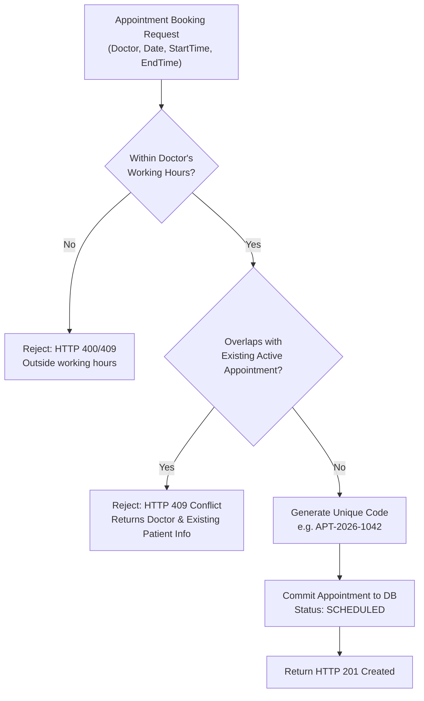
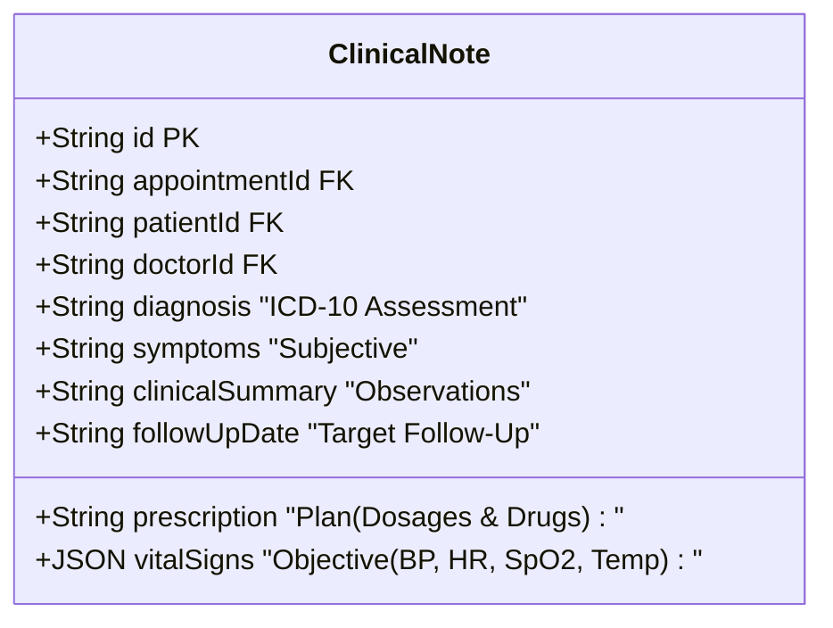

# 03 — Functionality & Business Logic

## 1. Feature Matrix by User Role

| Capability / Workflow | Receptionist | Doctor | Administrator |
| :--- | :---: | :---: | :---: |
| **Authenticate via JWT** | ✅ | ✅ | ✅ |
| **View Operational Dashboard** | ✅ (All Clinic) | ✅ (Doctor Scoped) | ✅ (All Clinic) |
| **Register New Patient** | ✅ | ❌ | ✅ |
| **Update Patient Demographics** | ✅ | ❌ | ✅ |
| **View Patient Directory** | ✅ (Full List) | ✅ (Assigned Only) | ✅ (Full List) |
| **View Patient Detail & Medical History** | ✅ | ✅ (Assigned Only) | ✅ |
| **View Doctor Availability Schedule** | ✅ | ✅ | ✅ |
| **Book Appointment with Conflict Check** | ✅ | ❌ | ✅ |
| **Reschedule Appointment** | ✅ | ❌ | ✅ |
| **Cancel Appointment with Reason** | ✅ | ✅ (Own Only) | ✅ |
| **Update Appointment Status (In Progress/Complete)** | ✅ | ✅ (Own Only) | ✅ |
| **Record Clinical SOAP Notes & Vitals** | ❌ | ✅ (Own Only) | ✅ |
| **View Clinical Notes Timeline** | ✅ | ✅ | ✅ |

---

## 2. Smart Scheduling & Conflict Detection Engine

The Scheduling Engine ensures zero scheduling clashes by evaluating working hours boundaries and performing temporal interval overlap checks against existing active appointments.



### Conflict Overlap Logic (Mathematical 3-Way Condition):
An appointment request for slot `[S_req, E_req]` conflicts with an existing appointment `[S_exist, E_exist]` if and only if:
1. **Slot starts during existing visit**: `S_exist <= S_req < E_exist`
2. **Slot ends during existing visit**: `S_exist < E_req <= E_exist`
3. **Slot engulfs existing visit**: `S_req <= S_exist` AND `E_req >= E_exist`

Only appointments with active statuses (`SCHEDULED`, `CONFIRMED`, `IN_PROGRESS`) trigger conflict rejections. Cancelled or completed slots are automatically freed.

### Doctor Availability Matrix Algorithm:
Given a doctor's working window (e.g. `09:00` to `17:00`) and slot duration (default `30` mins):
```typescript
let currentMinutes = startHour * 60 + startMin;
const endMinutes = endHour * 60 + endMin;

while (currentMinutes + slotDuration <= endMinutes) {
  const slotStart = formatTime(currentMinutes);
  const slotEnd = formatTime(currentMinutes + slotDuration);
  
  const isOccupied = existingAppointments.some(apt => 
    apt.startTime === slotStart || (slotStart >= apt.startTime && slotStart < apt.endTime)
  );

  slots.push({
    startTime: slotStart,
    endTime: slotEnd,
    isAvailable: !isOccupied,
    appointmentId: isOccupied ? matchingAppointment.id : undefined
  });

  currentMinutes += slotDuration;
}
```

---

## 3. Patient Lifecycle & Privacy Scoping

### 1. Patient Code Generation
Every newly registered patient receives an immutable unique identifier:
$$\text{Patient Code} = \text{"PT-"} + (10000 + \text{Total Count} + 1)$$
*Example*: `PT-10001`, `PT-10002`.

### 2. Multi-Field Search Engine
When searching patients, the backend splits query terms into tokens and applies matching across:
- First Name (`contains`)
- Last Name (`contains`)
- Patient Code (`contains`)
- Phone Number (`contains`)
- Email (`contains`)

### 3. Doctor-Patient Privacy Guard
```typescript
// Enforced in server/src/routes/patient.routes.ts
if (req.user?.role === 'DOCTOR' && req.user.doctorId) {
  where.appointments = {
    some: {
      doctorId: req.user.doctorId,
    },
  };
}
```
If a doctor attempts to access a patient profile `GET /api/patients/:id` who has never been scheduled with them, the API rejects the request with:
```json
{
  "error": "Access restricted: You may only view patient records for patients assigned to you."
}
```

---

## 4. Clinical Consultation & SOAP Note Framework

The clinic implements the gold-standard **SOAP** (Subjective, Objective, Assessment, Plan) consultation methodology:



### Vital Signs Typed JSON Object:
```json
{
  "bloodPressure": "120/80 mmHg",
  "heartRate": "72 bpm",
  "temperature": "98.6 °F",
  "respiratoryRate": "16 breaths/min",
  "oxygenSaturation": "99%",
  "weightKg": "70.5",
  "heightCm": "175"
}
```

---

## 5. RESTful API Specification

### Authentication Endpoints

#### 1. `POST /api/auth/login`
- **Description**: Authenticates user and returns a signed JWT.
- **Request Body**:
  ```json
  {
    "email": "receptionist@adrineclinic.com",
    "password": "password123"
  }
  ```
- **Response `200 OK`**:
  ```json
  {
    "token": "eyJhbGciOiJIUzI1NiIsInR5cCI6IkpXVCJ9...",
    "user": {
      "id": "u-rec-1",
      "email": "receptionist@adrineclinic.com",
      "name": "Emma Watson",
      "role": "RECEPTIONIST"
    }
  }
  ```

#### 2. `GET /api/auth/me`
- **Description**: Returns authenticated user profile based on Bearer token.
- **Headers**: `Authorization: Bearer <TOKEN>`

#### 3. `GET /api/auth/demo-users`
- **Description**: Returns pre-seeded demo accounts for quick role-switching in UI.

---

### Dashboard Endpoints

#### 1. `GET /api/dashboard`
- **Description**: Returns operational KPIs, today's queue, upcoming queue, and 7-day trend metrics.
- **Headers**: `Authorization: Bearer <TOKEN>`
- **Response `200 OK`**:
  ```json
  {
    "today": "2026-10-07",
    "metrics": {
      "todayTotal": 8,
      "todayCompleted": 3,
      "todayCancelled": 1,
      "todayInProgress": 1,
      "todayScheduled": 3,
      "upcomingTotal": 14,
      "totalPatients": 25,
      "allCompletedCount": 42,
      "allCancelledCount": 4
    },
    "todayQueue": [...],
    "upcomingQueue": [...],
    "weeklyActivity": [...]
  }
  ```

---

### Doctor Endpoints

#### 1. `GET /api/doctors`
- **Description**: Returns active doctors list with profiles, specializations, and working hours.

#### 2. `GET /api/doctors/:id/availability?date=YYYY-MM-DD`
- **Description**: Computes 30-min interval slot matrix indicating available vs booked times.

---

### Patient Endpoints

#### 1. `GET /api/patients`
- **Query Params**: `search`, `status`, `gender`, `bloodGroup`, `sortBy`, `sortOrder`, `page`, `limit`.
- **Response `200 OK`**:
  ```json
  {
    "patients": [...],
    "pagination": {
      "total": 25,
      "page": 1,
      "limit": 10,
      "totalPages": 3
    }
  }
  ```

#### 2. `GET /api/patients/:id`
- **Description**: Full patient dossier with complete appointment history and clinical notes timeline.

#### 3. `POST /api/patients`
- **Roles**: `RECEPTIONIST`, `ADMIN`
- **Request Body**:
  ```json
  {
    "firstName": "Arthur",
    "lastName": "Pendleton",
    "dateOfBirth": "1965-08-14",
    "gender": "Male",
    "phone": "+1-555-0199",
    "email": "arthur.p@example.com",
    "bloodGroup": "O+",
    "allergies": "Penicillin",
    "medicalHistory": "Hypertension, Hyperlipidemia",
    "status": "ACTIVE"
  }
  ```

---

### Appointment Endpoints

#### 1. `GET /api/appointments`
- **Query Params**: `doctorId`, `patientId`, `date`, `startDate`, `endDate`, `status`, `type`, `search`, `page`, `limit`.

#### 2. `POST /api/appointments`
- **Roles**: `RECEPTIONIST`, `ADMIN`
- **Request Body**:
  ```json
  {
    "patientId": "pat-123",
    "doctorId": "doc-456",
    "appointmentDate": "2026-10-07",
    "startTime": "10:30",
    "endTime": "11:00",
    "type": "CONSULTATION",
    "reason": "Chest tightness and palpitations"
  }
  ```
- **Conflict Response `409 Conflict`**:
  ```json
  {
    "error": "Conflict detected: Dr. Sarah Jenkins already has an active appointment (10:30 - 11:00) with patient Arthur Pendleton."
  }
  ```

#### 3. `PUT /api/appointments/:id/status`
- **Request Body**: `{ "status": "COMPLETED" | "CANCELLED" | "IN_PROGRESS", "cancellationReason": "..." }`

#### 4. `POST /api/appointments/:id/reschedule`
- **Request Body**: `{ "appointmentDate": "2026-10-08", "startTime": "14:00", "endTime": "14:30", "reason": "Patient requested afternoon" }`

---

### Clinical Note Endpoints

#### 1. `POST /api/clinical-notes`
- **Roles**: `DOCTOR`, `ADMIN`
- **Request Body**:
  ```json
  {
    "patientId": "pat-123",
    "appointmentId": "apt-789",
    "diagnosis": "Essential Hypertension (ICD-10 I10)",
    "symptoms": "Mild dizziness upon exertion",
    "prescription": "Amlodipine 5mg once daily",
    "vitalSigns": {
      "bloodPressure": "138/88 mmHg",
      "heartRate": "76 bpm",
      "temperature": "98.6 °F",
      "oxygenSaturation": "99%"
    },
    "clinicalSummary": "Lifestyle modifications advised.",
    "followUpDate": "2026-11-07",
    "markAppointmentCompleted": true
  }
  ```
