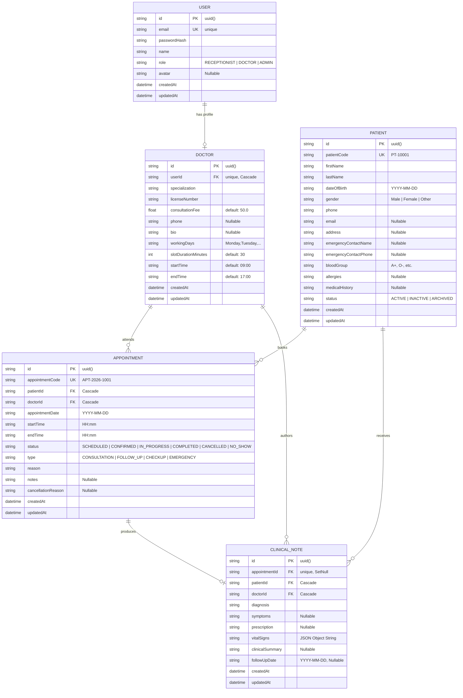

# 04 — Database & Data Architecture

## 1. Entity-Relationship Diagram (ERD)



---

## 2. Model Specifications & Schema Definitions

### 1. `User` Model
Represents system staff members (Receptionists, Doctors, Admins).
```prisma
model User {
  id           String    @id @default(uuid())
  email        String    @unique
  passwordHash String
  name         String
  role         String    @default("RECEPTIONIST") // RECEPTIONIST, DOCTOR, ADMIN
  avatar       String?
  createdAt    DateTime  @default(now())
  updatedAt    DateTime  @updatedAt

  doctorProfile Doctor?
}
```

### 2. `Doctor` Model
Extends `User` with clinical profile data, working hours, and consultation pricing.
```prisma
model Doctor {
  id                  String         @id @default(uuid())
  userId              String         @unique
  user                User           @relation(fields: [userId], references: [id], onDelete: Cascade)
  specialization      String
  licenseNumber       String
  consultationFee     Float          @default(50.0)
  phone               String?
  bio                 String?
  workingDays         String         @default("Monday,Tuesday,Wednesday,Thursday,Friday")
  slotDurationMinutes Int            @default(30)
  startTime           String         @default("09:00")
  endTime             String         @default("17:00")
  createdAt           DateTime       @default(now())
  updatedAt           DateTime       @updatedAt

  appointments        Appointment[]
  clinicalNotes       ClinicalNote[]
}
```

### 3. `Patient` Model
Stores comprehensive patient demographics, emergency contacts, medical history, and status.
```prisma
model Patient {
  id                    String        @id @default(uuid())
  patientCode           String        @unique
  firstName             String
  lastName              String
  dateOfBirth           String        // YYYY-MM-DD
  gender                String        // Male, Female, Other
  phone                 String
  email                 String?
  address               String?
  emergencyContactName  String?
  emergencyContactPhone String?
  bloodGroup            String?       // A+, A-, B+, B-, AB+, AB-, O+, O-
  allergies             String?       // Comma separated or text
  medicalHistory        String?       // Pre-existing conditions
  status                String        @default("ACTIVE") // ACTIVE, INACTIVE, ARCHIVED
  createdAt             DateTime      @default(now())
  updatedAt             DateTime      @updatedAt

  appointments          Appointment[]
  clinicalNotes         ClinicalNote[]
}
```

### 4. `Appointment` Model
Tracks outpatient visit bookings, time intervals, status transitions, and cancellation audits.
```prisma
model Appointment {
  id                 String         @id @default(uuid())
  appointmentCode    String         @unique
  patientId          String
  patient            Patient        @relation(fields: [patientId], references: [id], onDelete: Cascade)
  doctorId           String
  doctor             Doctor         @relation(fields: [doctorId], references: [id], onDelete: Cascade)
  appointmentDate    String         // YYYY-MM-DD
  startTime          String         // HH:mm (e.g. 09:30)
  endTime            String         // HH:mm (e.g. 10:00)
  status             String         @default("SCHEDULED") // SCHEDULED, CONFIRMED, IN_PROGRESS, COMPLETED, CANCELLED, NO_SHOW
  type               String         @default("CONSULTATION") // CONSULTATION, FOLLOW_UP, CHECKUP, EMERGENCY
  reason             String
  notes              String?
  cancellationReason String?
  createdAt          DateTime       @default(now())
  updatedAt          DateTime       @updatedAt

  clinicalNote       ClinicalNote?
}
```

### 5. `ClinicalNote` Model
Captures SOAP clinical consultation documentation, prescriptions, and vitals.
```prisma
model ClinicalNote {
  id              String        @id @default(uuid())
  appointmentId   String?       @unique
  appointment     Appointment?  @relation(fields: [appointmentId], references: [id], onDelete: SetNull)
  patientId       String
  patient         Patient       @relation(fields: [patientId], references: [id], onDelete: Cascade)
  doctorId        String
  doctor          Doctor        @relation(fields: [doctorId], references: [id], onDelete: Cascade)
  diagnosis       String
  symptoms        String?
  prescription    String?       // Drug name, dosage, frequency
  vitalSigns      String?       // JSON { bloodPressure, heartRate, temperature, respiratoryRate, oxygenSat, weightKg, heightCm }
  clinicalSummary String?
  followUpDate    String?       // YYYY-MM-DD
  createdAt       DateTime      @default(now())
  updatedAt       DateTime      @updatedAt
}
```

---

## 3. Relational Integrity & Cascading Constraints

| Relational Link | Foreign Key | Cascade Action | Rationale |
| :--- | :--- | :--- | :--- |
| `Doctor -> User` | `userId` | `onDelete: Cascade` | Removing a doctor user account automatically purges the doctor profile. |
| `Appointment -> Patient` | `patientId` | `onDelete: Cascade` | Deleting a patient profile removes associated appointment history. |
| `Appointment -> Doctor` | `doctorId` | `onDelete: Cascade` | Deleting a doctor cleans up assigned appointments. |
| `ClinicalNote -> Appointment` | `appointmentId` | `onDelete: SetNull` | If an appointment record is removed, the clinical note is preserved in the patient's permanent medical chart. |
| `ClinicalNote -> Patient` | `patientId` | `onDelete: Cascade` | Medical notes are tied to patient lifecycle. |

---

## 4. Pre-Seeded Realistic Demo Dataset

The database seeder (`server/src/prisma/seed.ts`) generates a complete, interconnected clinic ecosystem:

### Staff Accounts:
1. **Emma Watson** (`receptionist@adrineclinic.com`) — Clinic Front Desk Receptionist
2. **Dr. Sarah Jenkins** (`dr.sarah@adrineclinic.com`) — Specialist in Cardiology
3. **Dr. Marcus Vance** (`dr.marcus@adrineclinic.com`) — Specialist in Family Medicine
4. **Dr. Elena Rostova** (`dr.elena@adrineclinic.com`) — Specialist in Pediatrics

### Patients & Medical History:
- Over 25 pre-populated patient profiles with clinical histories (Hypertension, Asthma, Type 2 Diabetes, Penicillin allergies, Celiac disease).
- Chronological appointments across today, past dates (with completed SOAP notes and vital signs), and future dates for testing conflict management.

---

## 5. PostgreSQL Migration & Indexing Strategy for 100x Scale

When migrating from SQLite to PostgreSQL for high-scale enterprise deployment, the following compound and specialized indexes should be applied:

```sql
-- 1. Optimized appointment lookup & conflict checking
CREATE INDEX idx_appointments_doc_date_time 
ON "Appointment" (doctorId, appointmentDate, startTime, endTime);

-- 2. Patient search & filtering
CREATE INDEX idx_patients_status_name 
ON "Patient" (status, lastName, firstName);

-- 3. High-performance full-text search across patients
CREATE INDEX idx_patients_fulltext 
ON "Patient" USING GIN (to_tsvector('english', firstName || ' ' || lastName || ' ' || phone || ' ' || patientCode));

-- 4. Fast clinical notes retrieval by patient timeline
CREATE INDEX idx_clinical_notes_patient_date 
ON "ClinicalNote" (patientId, createdAt DESC);
```
